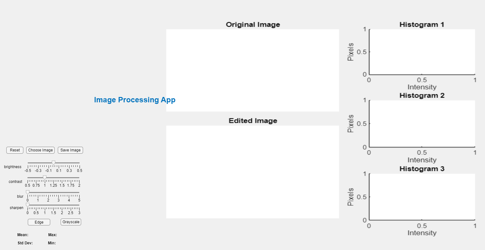

# MATLAB Image Processing App

An interactive image processing application built with **MATLAB App Designer**. Load an image, adjust it with live controls, apply filters, and inspect color histograms and image statistics that update in real time as you edit.



## Features

- **Load and save:** Open JPG, PNG, or BMP images and save the edited result as PNG or JPG
- **Side-by-side view:** Original and edited images displayed together
- **Live adjustments (sliders):**
  - Brightness (−0.5 to 0.5)
  - Contrast / gamma (0.5 to 2)
  - Gaussian blur (σ from 0 to 5)
  - Sharpening (amount from 0 to 3)
- **Filters (toggle buttons):**
  - Grayscale conversion
  - Canny edge detection
- **Live histograms:** Separate red, green, and blue channel histograms for color images, or a single intensity histogram for grayscale and edge images
- **Image statistics:** Mean, standard deviation, minimum, and maximum pixel intensity
- **Reset:** Restore the original image and all controls with one click

## Processing Pipeline

Every change re-renders the image from the original, in a fixed order, so adjustments never stack up or lose quality:

```
Original → Brightness → Contrast → Blur → Sharpen → Grayscale → Edge detection → Display + Histograms + Stats
```

## Requirements

- MATLAB **R2024a** or later
- **Image Processing Toolbox** (`imadjust`, `imgaussfilt`, `imsharpen`, `edge`)

## Getting Started

1. Clone the repository:
   ```bash
   git clone https://github.com/yuvalharari/matlab-image-processing-app.git
   ```
2. Open `FinalProject_matlab.mlapp` in MATLAB. It opens in App Designer.
3. Click **Run**, or run `FinalProject_matlab` from the MATLAB command window.
4. Click **Choose Image** to load any image from your computer.

## Project Structure

```
├── FinalProject_matlab.mlapp   # App Designer app (UI layout + code)
└── docs/
    └── app-screenshot.png      # App interface screenshot
```

## Project Context

An academic final project in MATLAB. It demonstrates GUI development with App Designer, event-driven programming, and core image processing techniques: intensity adjustment, spatial filtering, color space conversion, edge detection, and histogram analysis.
